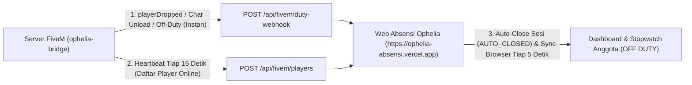

# Handbook Integrasi Server FiveM — Ophelia Attendance System (`ophelia-bridge` v2.0.0)

Dokumen ini adalah panduan teknis lengkap untuk **Developer Server FiveM** agar resource `ophelia-bridge` terpasang dengan benar, terhubung ke dashboard web absensi **https://ophelia-absensi.vercel.app**, dan fitur **Auto-Stop Absensi saat keluar kota / keluar server** berjalan tanpa kendala.

---

## 1. Ringkasan Cara Kerja Sistem



**Aturan Bisnis Utama:**
1. Anggota instansi (`Police`, `Medical/EMS`, `Mechanic`, `Restaurant/Pedagang`, `Pemerintah`) login di web memakai akun **Discord** lalu klik **START DUTY** setelah masuk kota FiveM.
2. Saat anggota **keluar server (`playerDropped`)**, **crash/DC**, atau **keluar kota ke menu pilih karakter (`OnPlayerUnload` / `onPlayerLogout`)**:
   - Resource FiveM langsung mengirim webhook instan ke web.
   - Sesi absensi otomatis ditutup (**`AUTO_CLOSED`**) dan durasi tercatat sampai detik terakhir sebelum keluar.
   - Stopwatch di browser anggota otomatis berhenti dalam hitungan detik.
3. Saat anggota masuk kembali ke kota, absensi **TIDAK otomatis lanjut** — anggota wajib memulai absensi ulang (`START DUTY` di web atau `/absensi start` di game).
4. Sebagai pengaman ganda jika ada gangguan jaringan saat disconnect, heartbeat setiap **15 detik** mengirim daftar semua pemain online (termasuk array kosong `[]` jika server kosong) sehingga sesi anggota yang sudah tidak di kota tetap otomatis ditutup.

---

## 2. File & Kredensial (Sudah Siap Pakai — Tanpa Edit)

Resource `ophelia-bridge` sudah diisi konfigurasi production di dalam `config.lua`:

| Parameter | Nilai Terpasang |
|---|---|
| **Resource Name** | `ophelia-bridge` |
| **Versi** | `2.0.0` (Universal: QBox / QBCore / ESX / Standalone) |
| **Download ZIP** | `https://ophelia-absensi.vercel.app/fivem-resource/ophelia-bridge.zip` |
| **Web Dashboard URL** | `https://ophelia-absensi.vercel.app` |
| **API Secret** | `oph_live_b4958b8b1f1eb1c1e7ca47dd8500fe4c8dcbe638ea45740e` |
| **Client Script** | **0 file** (100% server-side, 0 impact ke FPS player) |

Struktur folder resource:
```text
resources/
└── ophelia-bridge/
    ├── fxmanifest.lua
    ├── config.lua      <-- URL & Secret sudah terisi otomatis
    ├── server.lua
    └── README.md
```

---

## 3. Langkah Instalasi di Server FiveM (3 Menit)

### Langkah 1 — Upload Resource
Salin folder `ophelia-bridge` (atau ekstrak `ophelia-bridge.zip`) ke direktori `resources/` server FiveM (boleh di dalam subfolder kategori seperti `resources/[custom]/ophelia-bridge/`).

### Langkah 2 — Daftarkan di `server.cfg`
Tambahkan baris berikut di `server.cfg`. **Penting:** letakkan **di bawah** core framework (`qb-core` / `qbx_core` / `es_extended`) agar auto-detect framework langsung aktif saat startup:

```cfg
ensure ophelia-bridge
```

### Langkah 3 — Jalankan & Verifikasi di Console Server
Ketik perintah berikut di **server console / txAdmin console**:

```cfg
refresh
ensure ophelia-bridge
ophelia_status
```

**Output console yang menandakan pemasangan SUKSES:**
```text
[Ophelia Bridge] ========================================================
[Ophelia Bridge]   OPHELIA BRIDGE v2.0.0 — Attendance & Auto-Stop Engine
[Ophelia Bridge] ========================================================
[Ophelia Bridge]   Dashboard      : https://ophelia-absensi.vercel.app
[Ophelia Bridge]   Framework      : qbcore   (atau qbox / esx / standalone)
[Ophelia Bridge]   Sync Interval  : 15 detik
[Ophelia Bridge] Koneksi ke Web Absensi BERHASIL! (https://ophelia-absensi.vercel.app)
```

---

## 4. Checklist Pengujian (Wajib Tes Setelah Pasang)

Lakukan 4 tes singkat ini agar yakin 100% fitur berjalan sempurna di server:

1. **Cek Koneksi & Health**
   - Jalankan `ophelia_health` dan `ophelia_status` di console server.
   - Pastikan status **`CONNECTED`** dan jumlah `Player Aktif` menampilkan player yang sudah menautkan Discord di FiveM.
2. **Tes Masuk Kota & Start Duty**
   - Minta 1 staff (yang akun Discord-nya sudah tertaut di FiveM) masuk ke server sampai karakter spawn.
   - Buka web `https://ophelia-absensi.vercel.app` -> masuk ke instansi -> pastikan muncul badge hijau **`DI KOTA FIVEM #ID`**, lalu klik **`START DUTY`**.
3. **Tes Auto-Stop Saat Keluar Server (Disconnect / F8 Quit)**
   - Suruh staff tersebut keluar dari server FiveM (`quit` / disconnect).
   - Di console server akan muncul log:
     `[Ophelia Bridge] Sesi absensi ... berhasil di-AUTO STOP (durasi: Xs). Harus mulai ulang saat masuk kota.`
   - Dalam maks. 5 detik, halaman web staff tersebut otomatis berubah menjadi **`OFF DUTY`** dengan banner peringatan **Absensi Dihentikan Otomatis oleh Server FiveM**, dan di tabel Absensi tercatat status **`AUTO STOP`**.
   - *(Opsional simulasi cepat dari console tanpa disconnect player: jalankan `ophelia_testdrop <serverId>`).*
4. **Tes Masuk Kembali (Harus Mulai Ulang)**
   - Staff login kembali ke kota FiveM -> pastikan absensi di web **tetap `OFF DUTY`** sampai staff menekan **`START DUTY`** lagi.

---

## 5. Pengaturan Opsional di `config.lua`

Default `config.lua` sudah optimal untuk production, namun developer dapat menyesuaikan jika struktur job/multicharacter server berbeda:

| Opsi `config.lua` | Default | Fungsi |
|---|---|---|
| `Config.Framework` | `"auto"` | Auto-detect `qbox`, `qbcore`, `esx`, atau `standalone`. Bisa dipaksa manual bila perlu. |
| `Config.AutoStopOnDisconnect` | `true` | Auto-stop instan saat `playerDropped`. |
| `Config.AutoStopOnCharUnload` | `true` | Auto-stop instan saat player logout ke menu multicharacter (`QBCore:Server:OnPlayerUnload`, `qbx_core:server:onPlayerUnload`, `esx:onPlayerLogout`). |
| `Config.RequireLoadedCharacter` | `true` | Jika `true` (QBCore/QBox/ESX), player yang masih di menu pilih karakter **belum** dihitung online di kota. Ubah ke `false` jika server memakai custom multicharacter yang tidak memicu event standar. |
| `Config.AutoStopOnOffDuty` | `true` | Auto-stop jika player ganti status ke Off-Duty in-game atau pindah ke job di luar `Config.TrackedJobs`. |
| `Config.AutoStartOnInGameDuty` | `false` | **Disarankan tetap `false`** agar saat player rejoin, absensi tidak otomatis nyala lagi dan wajib dimulai ulang. |
| `Config.AutoStopAllOnShutdown` | `true` | Auto-stop semua sesi aktif saat server restart via txAdmin (`txAdmin:events:serverShuttingDown`). |
| `Config.EnableInGameCommands` | `true` | Mengaktifkan command `/absensi start` dan `/absensi stop` di dalam game. |
| `Config.SyncInterval` | `15000` | Interval heartbeat dalam milidetik (15 detik, minimal 10000). |
| `Config.Debug` | `false` | Set `true` (atau ketik `ophelia_debug` di console) untuk melihat log HTTP detail. |

### Menyesuaikan Nama Job Server (`Config.TrackedJobs`)
Jika di server kamu nama job berbeda (misal `ems` atau `bengkel` atau `lsc`), cukup tambahkan di `config.lua`:
```lua
Config.TrackedJobs = {
    ['police']     = 'police',
    ['ambulance']  = 'medical',
    ['ems']        = 'medical',
    ['mechanic']   = 'mechanic',
    ['pedagang']   = 'restaurant',
    ['resto']      = 'restaurant',
    ['pemerintah'] = 'pemerintah',
}
```

### Custom Multicharacter / Event Logout Tambahan
Jika server memakai script multicharacter custom yang tidak memicu `QBCore:Server:OnPlayerUnload` / `esx:onPlayerLogout`, developer cukup memicu event berikut dari script multicharacter saat karakter unload:
```lua
TriggerEvent("QBCore:Server:OnPlayerUnload", source)
```

---

## 6. Daftar Command

### Server Console Only (Admin / txAdmin)
| Command | Fungsi |
|---|---|
| `ophelia_status` | Menampilkan status koneksi, framework terdeteksi, jumlah sync, total sesi auto-stop, dan jumlah player bertaut Discord |
| `ophelia_sync` | Memaksa pengiriman daftar player online sekarang juga |
| `ophelia_health` | Mengecek konektivitas server FiveM ke `https://ophelia-absensi.vercel.app/api/fivem/health` |
| `ophelia_debug` | Toggle log debug ON / OFF tanpa perlu restart resource |
| `ophelia_testdrop <serverId>` | Menguji trigger webhook `PLAYER_DROPPED` untuk Server ID tertentu |

### In-Game Player (Opsional, via `Config.EnableInGameCommands`)
| Command | Fungsi |
|---|---|
| `/absensi start` | Memulai sesi absensi langsung dari dalam game (berdasarkan job saat ini) |
| `/absensi stop` | Menghentikan sesi absensi secara manual dari dalam game |

---

## 7. Referensi REST API (Untuk Integrasi Tambahan)

Semua request `POST` diautentikasi menggunakan header `X-API-Secret` dan/atau field JSON `secret`.

1. **Health Check**
   - `GET https://ophelia-absensi.vercel.app/api/fivem/health`
   - Response: `{ ok, service, version, serverConnected, lastHeartbeatAt, onlinePlayers, timestamp }`
2. **Sync Daftar Player Online (Heartbeat + Safety-Net Auto-Stop)**
   - `POST https://ophelia-absensi.vercel.app/api/fivem/players`
   - Body:
     ```json
     {
       "secret": "oph_live_b4958b8b1f1eb1c1e7ca47dd8500fe4c8dcbe638ea45740e",
       "players": [
         { "discordId": "123456789012345678", "serverId": 12, "name": "John Doe" }
       ]
     }
     ```
   - Response: `{ ok: true, synced, wentOffline, autoClosed, autoClosedSessions, timestamp }`
3. **Duty & Exit Webhook (Instan)**
   - `POST https://ophelia-absensi.vercel.app/api/fivem/duty-webhook`
   - Event didukung: `"PLAYER_DROPPED"`, `"PLAYER_UNLOADED"`, `"DUTY_OFF"`, `"DUTY_ON"`, `"SERVER_SHUTDOWN"`.
   - Body contoh:
     ```json
     {
       "secret": "oph_live_b4958b8b1f1eb1c1e7ca47dd8500fe4c8dcbe638ea45740e",
       "event": "PLAYER_DROPPED",
       "discordId": "123456789012345678",
       "serverId": 12,
       "playerName": "John Doe",
       "reason": "Exiting"
     }
     ```

---

## 8. Keamanan & Dampak Performa Server

- **0 Client Script**: Tidak ada file yang diunduh client, 0.00 ms client resmon.
- **Server Resmon Sangat Ringan**: Hanya 1 HTTP POST ringan (~1–2 KB) setiap 15 detik + 1 webhook saat disconnect.
- **Anti-Exploit**: Semua event handler adalah `AddEventHandler` server-side (bukan `RegisterNetEvent` yang bisa ditembak cheater dari client).
- **Privasi Data**: Hanya mengirim Discord ID, Server ID, Nama Karakter, CitizenID (opsional), dan nama/grade job. Tidak membaca password, IP, atau token pemain.

---

## 9. Troubleshooting Cepat

| Gejala / Pesan Console | Penyebab | Solusi |
|---|---|---|
| `HTTP 0` / Health check gagal | Server FiveM memblokir outbound HTTPS atau DNS bermasalah | Pastikan firewall VPS/RDP mengizinkan outbound HTTPS (port 443) ke `ophelia-absensi.vercel.app` |
| `HTTP 401 Unauthorized` | `FIVEM_API_SECRET` di Vercel berbeda dengan `Config.Secret` | Samakan nilai `FIVEM_API_SECRET` di Vercel Environment Variables dengan `Config.Secret` di `config.lua` |
| Player sudah masuk kota tapi web bilang **Offline / Di Luar Kota** | Player belum link Discord ke FiveM, atau karakter belum spawn | Pastikan Discord desktop terbuka & tertaut di FiveM (`Settings -> Linked Accounts -> Discord`). Cek dengan `ophelia_debug` lalu `ophelia_sync` |
| `Player Aktif: 0 / X total` padahal player sudah spawn | Server pakai custom core/multicharacter | Coba set `Config.RequireLoadedCharacter = false` atau `Config.Framework = "standalone"` di `config.lua` lalu `restart ophelia-bridge` |
| Absensi tidak auto-stop saat player disconnect | Versi web lama belum ter-deploy ke Vercel | Pastikan versi kode web terbaru sudah di-deploy ke `https://ophelia-absensi.vercel.app` |

---

## 10. Opsional — RDP MariaDB Bridge (`fivem-bridge/`)

> **Catatan:** Bagian ini **TIDAK WAJIB** untuk fitur Auto-Stop Absensi. Hanya diperlukan jika ingin menampilkan **Saldo Kas Instansi In-Game** (`bablo_bank_accounts`) secara live di dashboard web.

Jika ingin mengaktifkan saldo kas in-game:
1. Salin folder `fivem-bridge/` ke RDP server MariaDB, jalankan `npm install`.
2. Salin `.env.example` menjadi `.env`, isi kredensial MariaDB (`MYSQL_USER`, `MYSQL_PASSWORD`, `MYSQL_DATABASE`).
3. Jalankan dengan PM2: `pm2 start server.js --name ophelia-db-bridge`.
4. Buka Inbound Port `3001` TCP di Windows Firewall RDP dan set `FIVEM_BRIDGE_URL="http://<IP_RDP>:3001"` di Vercel.

---

## 11. Template Pesan Siap Kirim ke Developer (Discord / WhatsApp)

```text
Halo dev, ini paket resource FiveM v2.0.0 untuk integrasi web absensi Ophelia (auto-stop otomatis kalau anggota keluar kota / keluar server):

[DOWNLOAD RESOURCE ZIP]
https://ophelia-absensi.vercel.app/fivem-resource/ophelia-bridge.zip

[STATUS KONFIGURASI]
URL web (https://ophelia-absensi.vercel.app) dan API Secret sudah terisi otomatis di dalam config.lua — tidak perlu edit apa-apa lagi.
Support otomatis: QBox / QBCore / ESX / Standalone, 0 client script (tidak ngaruh FPS).

[CARA PASANG]
1. Extract folder `ophelia-bridge` ke dalam `resources/`
2. Tambahkan `ensure ophelia-bridge` di `server.cfg` (di bawah framework)
3. Jalankan di console server:
   refresh
   ensure ophelia-bridge
   ophelia_status

Kalau sudah muncul "CONNECTED" di `ophelia_status`, integrasi sudah aktif.
Dokumentasi lengkap API & troubleshooting: https://ophelia-absensi.vercel.app/api-docs/fivem
Makasih!
```
